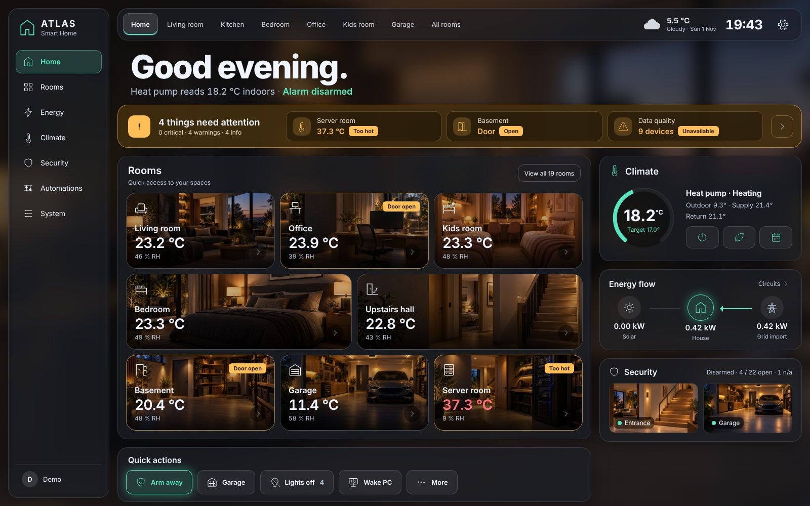
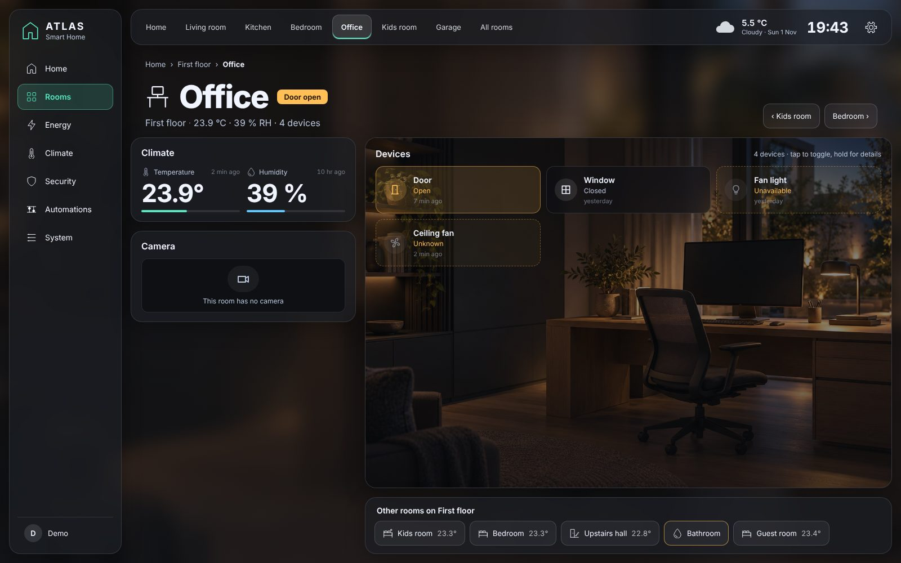
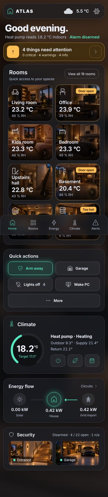
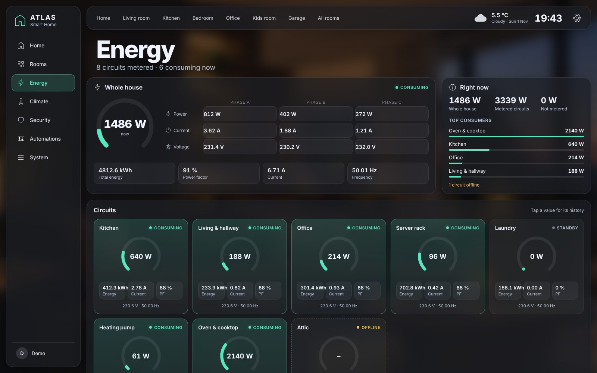
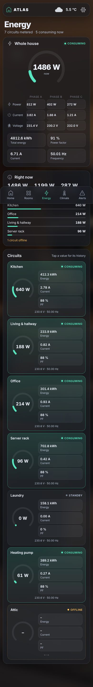

# ATLAS Home Dashboard

Attention-first Home Assistant dashboard. It shows what needs attention first, then rooms by floor and one view per room, in the ATLAS design: dark glass panels over a blurred room photo, mint accent, amber attention strip.



| Room view | Phone |
| --- | --- |
|  |  |
|  |  |

Screenshots show the fictional demo house (`src/config/preset-demo.ts`) with mocked states, not a real home.

## Features

- **Home:** time-aware greeting with heat pump reading and alarm state, attention banner (critical / warning / info), 8 photo room tiles, quick actions (Arm away, Garage, Lights off with confirmation, Wake PC), climate ring, energy flow, security with live 16:9 camera stills.
- **Alerts:** grouped by severity. Rules for temperature limits with hysteresis, doors, unavailable devices, incident report, mailbox, updates. Unknown or unavailable is never treated as clear. Details: [docs/alerts.md](docs/alerts.md).
- **Rooms:** floors (+2 to -1) with room count, typical temperature and alert count; room tiles per floor.
- **Room:** climate, camera that starts live (muted) when the room opens (16:9, Live, Snapshot, Recordings; private camera hidden until Reveal), device tiles on the room image (tap toggles, hold opens details), previous / next room. Device tiles show how long ago each entity changed. Optional **Remote** card per room with a TV (power, volume, playback, source, arrow pad for Android TV, Samsung, LG webOS, Apple TV, Roku).
- **Energy:** whole-house meter with phases A/B/C, a "right now" summary with top consumers, and a gauge card per metered circuit (W, status, kWh, A, PF, V, Hz). Set up in Edit dashboard > Energy (`energy_meters`).
- **Fully configurable in the UI:** every entity, room, floor, device, alert rule and layout list in Edit dashboard. Reference: [docs/configuration.md](docs/configuration.md).
- **Styles:** Warm glass, Glass, Quiet (no blur, for the wall tablet), 5 ambiences, adjustable accent; per-device override with the gear icon.
- **Own URL per screen:** browser back and deep links work.
- **Responsive:** desktop, 10 inch tablet, phone (bottom navigation).

## Install (HACS custom repository)

1. HACS > three dots > **Custom repositories** > add `https://github.com/robman2026/AttlasDashboard`, type **Dashboard**.
2. Download **ATLAS Home Dashboard**. HACS adds the resource `/hacsfiles/AttlasDashboard/atlas-home.js` (JavaScript module). If not, add it under Settings > Dashboards > three dots > Resources.
3. Reload the browser.
4. Settings > Dashboards > **Add dashboard** > Community dashboards > **ATLAS Home** (HA 2026.5 or newer).
   Alternative: create an empty dashboard, open the raw configuration editor and paste
   ```yaml
   strategy:
     type: custom:atlas-home
   ```
5. The editor opens. Either click **Load demo house** and replace the demo entities with yours, or switch to YAML (three dots > Edit in YAML) and paste your own config. **Save**.

Existing dashboards are not changed.

## Keep your house private

Your real configuration (entity IDs, room names) lives only in your Home Assistant dashboard. If you keep a copy next to the code, name it `*.private.yaml`: these files are git-ignored and never pushed.

## Configure

Open the dashboard > three dots > **Edit dashboard**. Tabs: General, Entities, Alerts, Floors, Rooms, Layout. The dialog's three dots menu also offers YAML.

Every option with type, default and description: **[docs/configuration.md](docs/configuration.md)** (generated from the code, always current).

## Documentation

| | |
| --- | --- |
| [docs/configuration.md](docs/configuration.md) | All options and the demo house config |
| [docs/alerts.md](docs/alerts.md) | How each alert rule works |
| [docs/architecture.md](docs/architecture.md) | Views, URLs, source map, design tokens, HA APIs |
| [docs/development.md](docs/development.md) | Build, preview, screenshots, release, documentation policy |
| [CHANGELOG.md](CHANGELOG.md) | Changes per version |
| [docs/design.md](docs/design.md) | Design brief and milestones |

## Status

Version 0.1.0: first development build, not yet tested on a live instance. Milestones: [docs/design.md](docs/design.md), changes: [CHANGELOG.md](CHANGELOG.md).

## License

MIT
